<div align="center">


**Point your watch (or your phone) at the sky and it tells you what you're looking at.**


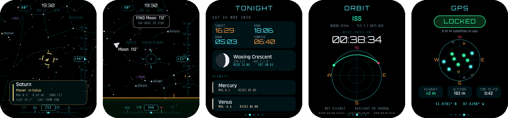

<sub>Screen pictures are renders of the real interface from the desktop simulator, not photographs.</sub>

</div>

SkyPoint is a pocket planetarium you point at the sky. It runs on the **LilyGO T-Watch Ultra**, the **Waveshare ESP32-C6-Touch-AMOLED-2.06** and **Android** phones. Everything is calculated on the device: 1,675 stars, the constellations, the Sun, Moon and planets, 109 Messier objects, and the ISS, Tiangong and Hubble with their passes over you.

**Get it:** [Web flasher](https://skirf-labs.tech/SKYPOINT/) · [Releases](https://github.com/SKIrf26/SKYPOINT/releases) · **Guide:** [User guide (PDF)](docs/SkyPoint_Beta_1_User_Guide.pdf) · booklets to print two-sided: [flip on short edge](docs/SkyPoint_Beta_1_User_Guide_BOOKLET_flip-short-edge.pdf) / [flip on long edge](docs/SkyPoint_Beta_1_User_Guide_BOOKLET_flip-long-edge.pdf)

## What it does

SkyPoint turns the watch into a window on the sky. Hold it up, look "through" it, and the AMOLED shows what is behind it, live as you move:

- **1,675 stars**, colour-true from their B-V index, twinkling, with names and Greek letters
- **88 constellation figures** and names
- **Sun, Moon and all 7 planets**. The Moon is drawn with its real phase, lit from the side the Sun is on. Saturn has rings.
- **109 Messier objects**: Orion Nebula, Andromeda, the Pleiades and the rest
- **Satellites** (ISS, Tiangong, Hubble) as live icons with a dotted 10-minute predicted track
- A fighter-jet HUD: reticle, altitude ladder, compass tape, a glowing horizon with cardinal points, and a ground plane. "See through Earth" shows what's below the horizon, dimmed.
- **Lock-on**: centre something and the brackets snap onto it, the watch ticks, and a card slides up with name, type, constellation, magnitude, distance, altitude and azimuth.
- **Find mode**: pick anything on the Tonight or Orbit page and an arrow guides you there. It ticks every 10° closer and double-buzzes when it's in the reticle.
- **Tonight**: sunset, astronomical dark, dawn and sunrise; Moon phase, rise and set; every planet (up, or when it rises); bright stars and deep-sky objects that are up now.
- **Orbit**: countdown to the next pass, a polar sky plot of the track, rise/peak/set times and directions, whether the pass is visible to the eye, and later passes. A visible ISS pass sets off an alert 2 minutes before rise and starts Find mode when it rises.
- **GPS page** (T-Watch): LOCKED / SEARCHING status, a radar plot of the satellites in view (filled = used in the fix, colour = signal), accuracy, altitude, time-to-fix. A buzz and a toast when the lock arrives, wherever you are in the app.
- **Sounds**: tap blips, lock-on chirps, find/align/GPS chimes, ISS alert, boot sweep. Volume slider in SETUP (0 = off); a Vibration switch on the T-Watch.
- **Big-key keyboard** for Wi-Fi passwords (after the Wardriver design): 15 large keys per page, letters a-o / p-z, numbers, two symbol pages.
- **Night vision**: one switch turns the whole UI red so your eyes stay dark-adapted.

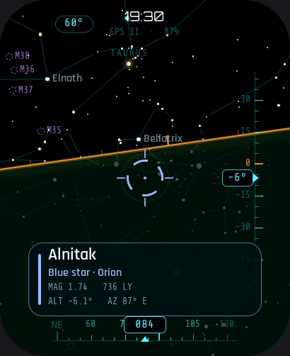 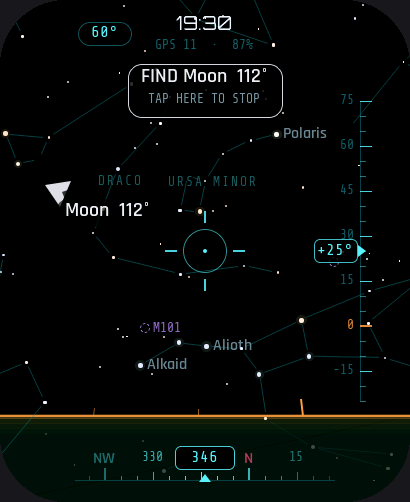 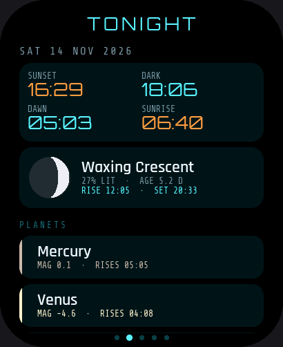 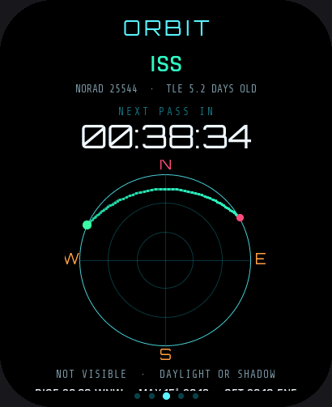 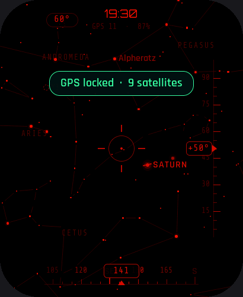 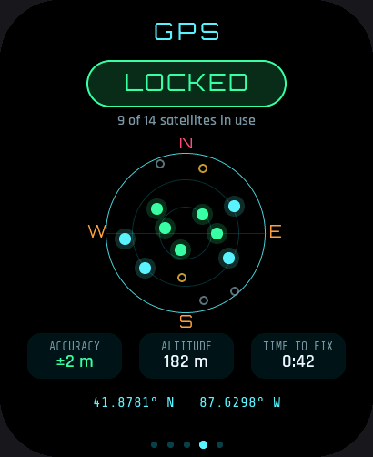

## Boards

| | LilyGO T-Watch Ultra | Waveshare ESP32-C6-Touch-AMOLED-2.06 |
|---|---|---|
| Chip | ESP32-S3, 8 MB PSRAM | ESP32-C6, no PSRAM, no FPU |
| Orientation | BHI260AP on-chip fusion (game rotation vector) | QMI8658 6-axis + Mahony filter in firmware, gyro bias learnt when still |
| Time | GNSS, kept in the PCF85063 RTC | NTP over Wi-Fi, kept in the PCF85063 RTC |
| Position | GNSS (or pick a city indoors) | Wi-Fi IP lookup (city-level) or pick a city |
| Haptics | DRV2605 | none (no motor) |
| How it runs | Standalone, or as an app from [bmorcelli's Launcher](https://github.com/bmorcelli/Launcher) | Standalone |
| Buttons | Side button: click = next page, double-click = night vision | BOOT: same. PWR short press = screen off/on |

There is also an **Android app** (below) (Android 8+): same look, same catalogue, but the phone's compass gives true north straight away (corrected for magnetic declination), plus an optional AR camera view. See [`android/README.md`](android/README.md).

Neither watch board has a magnetometer, so the watch knows exactly which way is **down** but not where **north** is. Altitude is always correct. Azimuth is set once per session by aligning on something you can see (see below).

## Using it

1. **Swipe** left and right between SKY, TONIGHT, ORBIT and SETUP.
2. **Align heading** (once per session): long-press the sky, or go to SETUP > Align heading. Pick the Moon, a planet or a bright star that you can actually see. A dashed amber line shows its altitude. Raise the watch to that line, turn until the object is in the reticle, then long-press. You can also choose "Face north".
   *Re-align at any time:* when the reticle is locked on something real and you're centred on it, long-press.
3. **Tap the sky** to zoom: 90°, 60°, 35°, 20°.
4. **Tap any row** on TONIGHT or ORBIT to start Find mode. Tap the banner to stop.

**Pointing** (SETUP): *Viewfinder* (default) means you look through the watch. *Pointer* means you aim the watch's 12 o'clock edge, like a laser pointer.
**Sensor axis** (SETUP): if the sky moves the wrong way on your unit, step this through 0/90/180/270°.

### Getting time, position and orbits

- **T-Watch Ultra:** go outside once and the GNSS sets the clock (saved to the RTC) and your position (saved to flash). Orbits: SETUP > Wi-Fi, choose your network and type the password, then *Update orbits*. You can also put `/skypoint/wifi.txt` on the SD card (SSID on line 1, password on line 2), or drop a TLE file at `/skypoint/tle.txt`.
- **Waveshare C6:** SETUP > Wi-Fi, then *Sync over Wi-Fi*. This sets the clock by NTP, finds your approximate position from your internet address (ip-api.com), and downloads orbits from CelesTrak. If you'd rather not use the IP lookup, choose a city under SETUP > Location; a chosen city is never overwritten.
- Orbital elements go stale. The ORBIT page shows their age; update when it's over a week.

## Android app

<table>
<tr>
<td>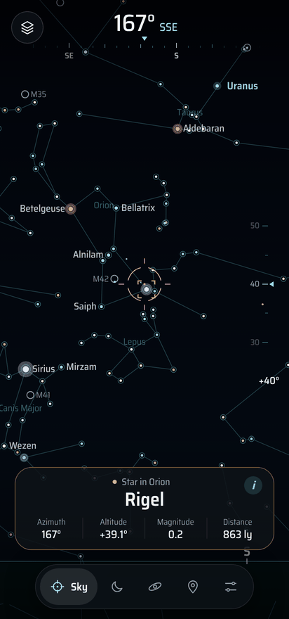</td>
<td>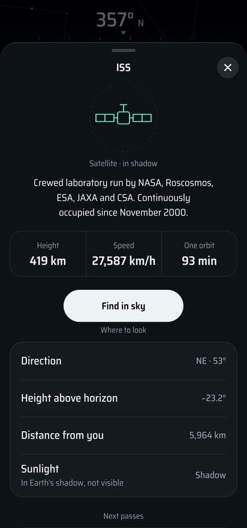</td>
<td>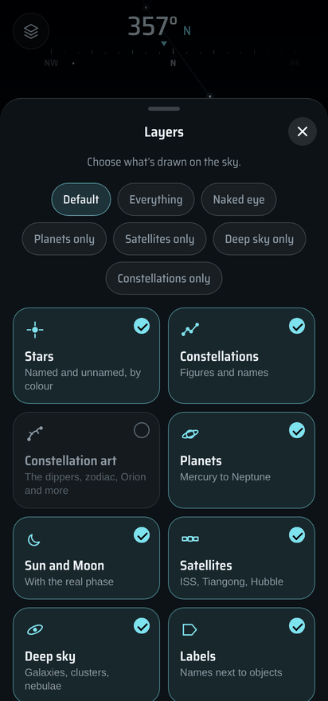</td>
<td>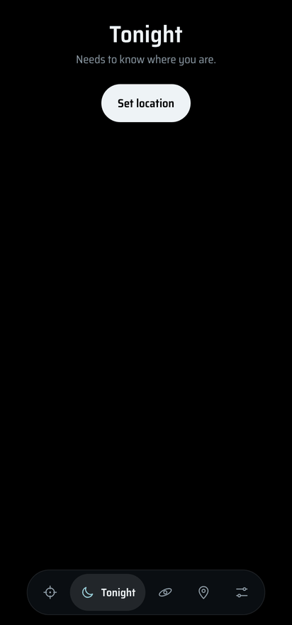</td>
<td>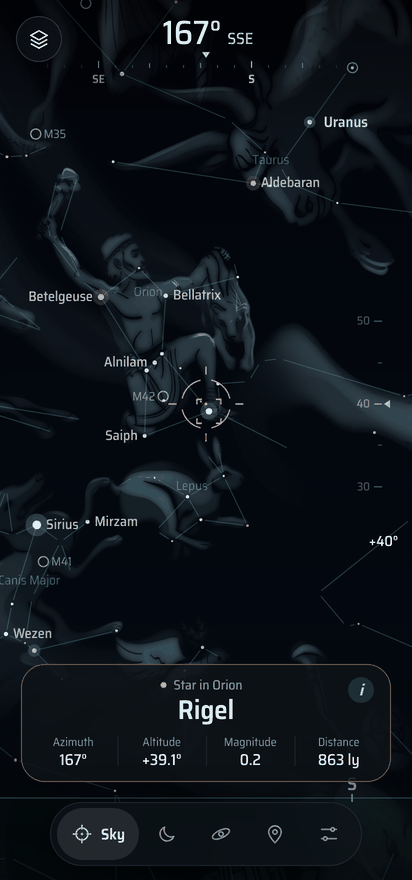</td>
</tr>
<tr align="center"><td>Sky</td><td>Info sheet</td><td>Layers</td><td>Tonight</td><td>Constellation art</td></tr>
</table>

The same sky on a phone (Android 8.0+), no watch needed. The phone's compass gives **true north** straight away (corrected for magnetic declination), with an optional **camera view**, pinch zoom, **layers** (stars, constellations, drawings, planets, Sun and Moon, satellites, deep sky), an **info sheet** for every object with its Wikipedia summary, portrait / auto / landscape rotation, and a GPS sky plot. Details in [`android/README.md`](android/README.md).

Install `SkyPoint_1.0_Beta_1.apk` from the [web flasher](https://skirf-labs.tech/SKYPOINT/) (open it on the phone) or [Releases](https://github.com/SKIrf26/SKYPOINT/releases): open it on the phone and allow the install (Play Protect may ask: **More details › Install anyway**).

## Install

The easiest way is the **[SkyPoint Web Flasher](https://skirf-labs.tech/SKYPOINT/)**: plug in the watch, click Install, done. It needs Chrome or Edge on a computer. Open the same page on your phone to download the Android app. (The site's source is in [`web/`](web/) if you want to host your own copy.)

| File (from Releases) | For | How |
|---|---|---|
| `SkyPoint_TWatchUltra_Beta_1.bin` | T-Watch Ultra, standalone | `esptool --chip esp32s3 write-flash 0x0 SkyPoint_TWatchUltra_Beta_1.bin` (replaces Launcher) |
| `SkyPoint_TWatchUltra_Beta_1_Launcher.bin` | T-Watch Ultra with [bmorcelli's Launcher](https://github.com/bmorcelli/Launcher) | Copy to the SD card and install it from Launcher. SETUP › *Exit to Launcher* goes back. |
| `SkyPoint_WaveshareC6_AMOLED206_Beta_1.bin` | Waveshare C6 AMOLED 2.06 | `esptool --chip esp32c6 erase-flash`, then `esptool --chip esp32c6 write-flash 0x0 SkyPoint_WaveshareC6_AMOLED206_Beta_1.bin`. Hold BOOT while plugging in if it won't connect. |
| `SkyPoint_1.0_Beta_1.apk` | Android 8.0+ | Open on the phone and allow the install. |

Check downloads against `SHA256SUMS.txt`.

## Build from source

Libraries: [LilyGoLib](https://github.com/Xinyuan-LilyGO/LilyGoLib) + LilyGoLib-ThirdParty (T-Watch, also provides lvgl 9), [Sgp4](https://github.com/Hopperpop/Sgp4-Library), and for the C6, [GFX Library for Arduino](https://github.com/moononournation/Arduino_GFX) 1.6.x. ESP32 core 3.3.x.

The sketch is in `SkyPoint/`. All code lives in the `.cpp` files. The `.ino` is intentionally empty.

```
# T-Watch Ultra
arduino-cli compile -b esp32:esp32:twatch_ultra --export-binaries SkyPoint

# Waveshare C6 (uses its own lv_conf.h: libc heap, no PSRAM)
CONF=$PWD/boards/waveshare-c6-amoled206/lv_conf.h
arduino-cli compile -b "esp32:esp32:esp32c6:CDCOnBoot=cdc,FlashSize=4M,PartitionScheme=huge_app" \
  --build-property "compiler.cpp.extra_flags=-DLV_CONF_PATH=\"$CONF\"" \
  --build-property "compiler.c.extra_flags=-DLV_CONF_PATH=\"$CONF\"" --export-binaries SkyPoint
```
In the Arduino IDE (C6), copy `boards/waveshare-c6-amoled206/lv_conf.h` into your `Arduino/libraries/` folder, next to `lvgl/`, and remove it again before building for the T-Watch.

### Android app

The phone version lives in [`android/`](android/README.md): a small Java shell (sensors, GNSS, camera permission, vibration, network) around a web sky engine in `android/assets/www/`. It builds without Gradle in a few seconds:

```
cd android
SKYPOINT_KS_PASS=yourpassword ./build.sh      # -> build/SkyPoint_1.0_Beta_1.apk
```

Open `android/assets/www/index.html?lat=41.88&lon=-87.63&az=150&alt=35&nointro` from any local web server to work on the UI in a desktop browser (drag to look around, wheel to zoom).

### User guide
```
python3 tools/guide/make_guide.py    # docs/SkyPoint_Beta_1_User_Guide.pdf + two booklets
```

### Tests and simulator
```
test/run.sh                          # astronomy + SGP4 checked against PyEphem
tools/simulator/build_and_run.sh     # renders every screen to docs/screenshots/
```
The astronomy engine is checked against PyEphem: Sun, Moon and inner planets within 1′, Jupiter and Saturn within 5′, rise and set times within about 2 minutes, and ISS positions and passes to the second.

## How it works

| File | What |
|---|---|
| `astro.*` | Sidereal time, precession, Sun, Moon (Meeus ELP terms + topocentric parallax), planets (JPL Keplerian elements + light time), magnitudes, phases, rise and set |
| `sats.*` | SGP4 tracking, pass finder (horizon crossings + golden-section peak), TLE parsing with checksum and newest-epoch rules |
| `sky.*` | The live sky in local East-North-Up coordinates, camera projection, object info and picking |
| `orient.*` | IMU quaternion to camera; adaptive smoothing; auto-detects the quaternion convention from gravity; heading alignment |
| `skyview.*` | The renderer. Records a display list once per frame and replays it per screen stripe, so the C6 doesn't redo the maths for every stripe. |
| `ui.*` | Pages, modals, Find mode, pass alerts, intro |
| `device.cpp` / `device_c6.cpp` | Board layers |
| `netsync.*` | Wi-Fi, NTP, IP location, CelesTrak |
| `catalog_data.h` | Generated by `tools/gen_catalog.py` |

## Responsible use

Never look at the Sun, directly or through binoculars, a telescope or a camera. SkyPoint shows where it is in daytime; don't use that to line anything up with it. Watch where you're walking when you look up at a screen in the dark.

## Contributing and support

Bug reports and ideas are welcome: use the **Bug report** or **Feature request** forms on the Issues tab. See [CONTRIBUTING.md](CONTRIBUTING.md) and [SECURITY.md](SECURITY.md).

## Credits and licences

SkyPoint is GPL-3.0. Data and fonts:
- Stars: [HYG Database](https://github.com/astronexus/HYG-Database) v4.1, CC BY-SA 4.0
- Constellation figures: [Stellarium](https://github.com/Stellarium/stellarium) "modern" sky culture, GPL-2.0-or-later
- Planet elements: E. M. Standish, JPL. Moon and Sun series: J. Meeus, *Astronomical Algorithms*.
- SGP4: Hopperpop/Sgp4-Library (MIT), after Vallado
- Orbital elements: CelesTrak
- Fonts: Orbitron, Rajdhani, Share Tech Mono, Noto Sans (Greek), Saira Semi Condensed, all SIL OFL 1.1
- Android: Astronomy Engine (MIT), satellite.js (MIT), constellation drawings by Johan Meuris for Stellarium (Free Art License 1.3)

Full notices: [THIRD_PARTY_NOTICES.md](THIRD_PARTY_NOTICES.md).
- Pin map and chip notes for the Waveshare board come from the HUNTR-SEEKR port
